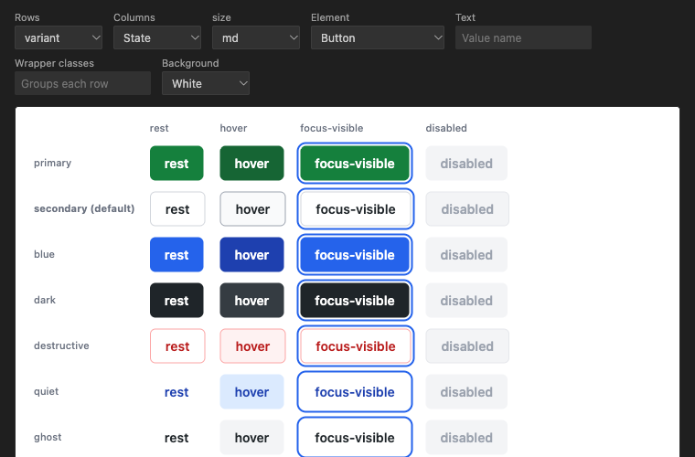

# CVA Preview

Install from the [VS Code Marketplace](https://marketplace.visualstudio.com/items?itemName=Minhh.cva-preview) or [Open VSX](https://open-vsx.org/extension/Minhh/cva-preview) (Cursor, VSCodium).

Renders every variant of a [class-variance-authority](https://cva.style) definition next to the code, styled with the project's own Tailwind 4 theme.



- A **Preview variants** CodeLens sits above each `cva(...)` call. The command palette has **CVA Preview: Preview cva variants at cursor**.
- Pick any variant (or **State**) for rows and columns; other variants get a fixed value. Defaults are marked.
- States are read from the class prefixes (`hover:`, `focus-visible:`, `disabled:`, `aria-pressed:`, `has-checked:` …) and forced on, so hover and focus show without a pointer.
- `has-*` states need **Element: Label around a radio**. **Wrapper classes** puts each row inside one element, for joined groups.
- Click a cell to copy its call, for example `buttonVariants({ variant: "primary", size: "sm" })`. Hover a cell for its class list.
- The preview follows unsaved edits, and stylesheet saves.

## Stylesheet

The nearest `.css` file that imports `tailwindcss` is used. Set `cvaPreview.cssEntry` (relative to the workspace folder) to choose one. CSS is built with the project's own `@tailwindcss/node`, so Tailwind 3 is not supported.

## Limits

Only literal configs are read. Classes built from variables or spreads are listed as problems above the preview.

## Development

```sh
pnpm install
pnpm test
pnpm typecheck
pnpm harness <file.ts> <entry.css>   # writes dist/harness-<file>.html for a browser check
pnpm package                         # cva-preview-<version>.vsix
code --install-extension cva-preview-0.1.0.vsix
OVSX_PAT=… pnpm publish:openvsx      # Open VSX; the VS Code Marketplace takes the .vsix by upload
```
